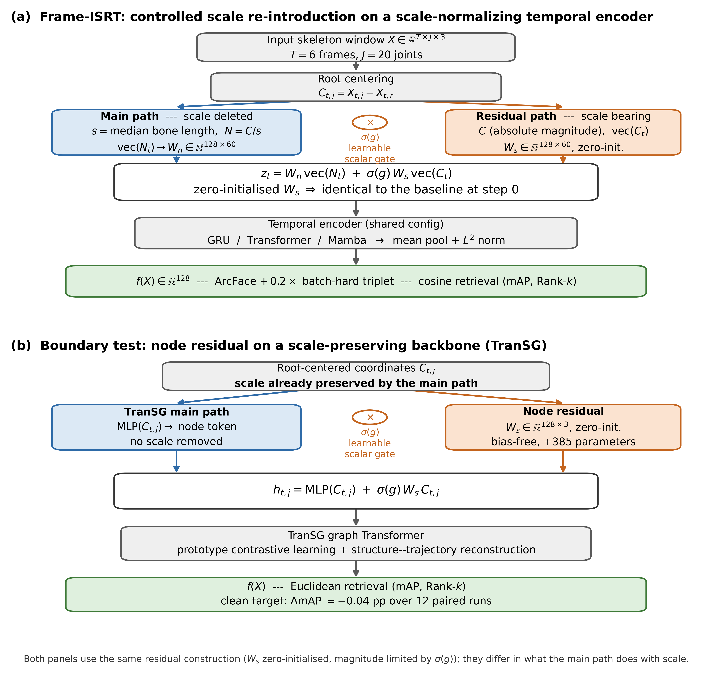
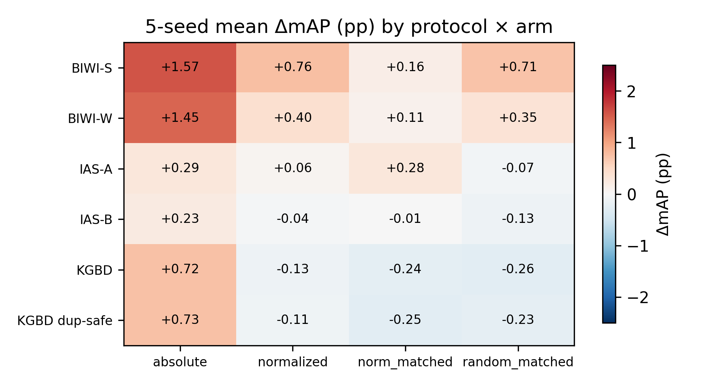
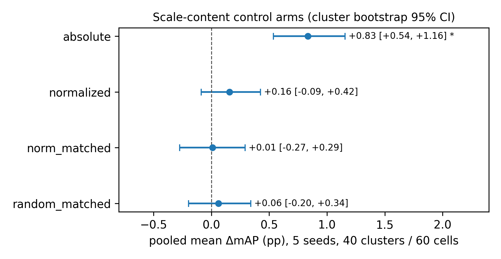
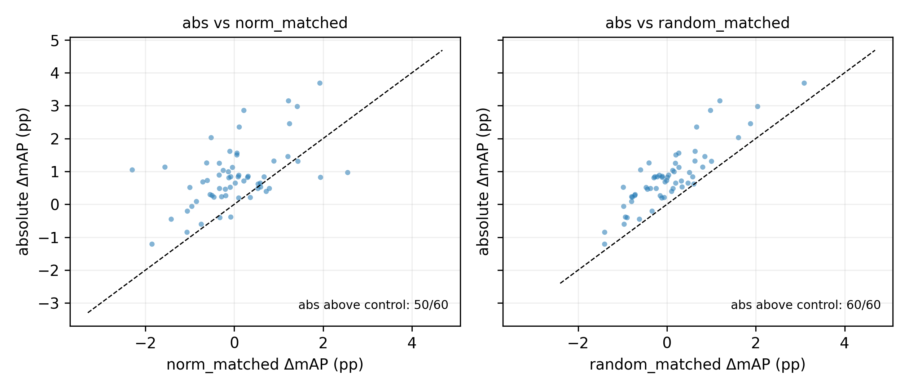
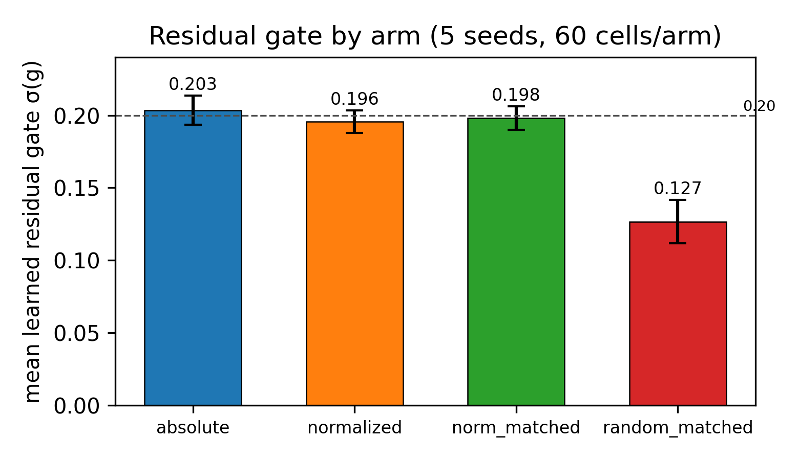

# Frame-ISRT

Controlled **Identity-Scale-Residual (ISR)** tokens for short-window 3D-skeleton
person re-identification. This repository ships the code and per-seed results
behind the Frame-track experiments of the manuscript
*Controlled Scale-Bearing Residuals for Short-Window 3D Skeleton Person
Re-Identification: Magnitude-Matched Controls and the Scale-Deletion Boundary*.

## Idea in one paragraph

ISR-GRU / ISR-Transformer / ISR-Mamba keep a strong temporal backbone (GRU,
Transformer, or Mamba) but change the input tokens: the scale-normalized stream
is projected as usual, and a **zero-initialized, gated projection of the
root-centered (absolute-scale) residual** is added to it. The gate σ(g) is
learned and stays small (≈0.20). To decide whether that small absolute-scale
injection actually matters, the mechanism is evaluated against four
*scale-content control arms* that are parameter-identical to the absolute arm:

| arm | residual input | scale content |
|---|---|---|
| `absolute` (C) | root-centered coordinates C | full absolute scale |
| `normalized` (C/s) | median-bone-length normalized N = C/s | removed |
| `norm_matched` (N·γ) | N re-scaled to the absolute RMS/variance | magnitude-matched, no per-sample scale |
| `random_matched` | per-sample RMS-matched Gaussian noise | none (random shape) |

Pooled over 6 protocols × 2 backbones × 5 seeds (60 cells; 40 independent
training runs), only the `absolute` arm improves mAP:

```
absolute        +0.83 pp   cluster-bootstrap 95% CI [+0.54, +1.16]   p < 0.0001
normalized      +0.16 pp   CI [−0.09, +0.42]                         p = 0.27
norm_matched    +0.01 pp   CI [−0.27, +0.29]                         p = 0.95
random_matched  +0.06 pp   CI [−0.20, +0.34]                         p = 0.68
```

The statistics above are cluster-aware: the valid resampling unit is the
independent training run `(dataset family, backbone, seed)` — the BIWI pair and
the IAS pair share byte-identical training windows/checkpoints, and KGBD
official vs. KGBD duplicate-safe are separate train sets. See
`experiments/scale_content_controls/aggregate/pooled_frame_stats_cluster.md`.

## Figures

The five manuscript figures. The four analysis plots are generated from
`results/per_seed_frame.csv`; the method overview is a schematic. File names are
the repository's, and the manuscript figure number is given in each caption.

**Figure 1 — Method overview** (`scripts/make_method_figure.py`). Panel (a):
Frame-ISRT re-introduces absolute scale through a zero-initialized, scalar-gated
residual token on a scale-normalizing encoder. Panel (b): the same construction
on TranSG, whose main path already preserves scale — the boundary test.



**Figure 2 — Five-seed mean ΔmAP (pp) by protocol × scale-content arm**
(`scripts/make_p2_figures.py`). The absolute arm is positive on most protocols;
the three controls cluster near zero.



**Figure 3 — Pooled arm effect with cluster block bootstrap 95% CI**
(`scripts/make_p2_figures.py`). Only the absolute arm excludes zero.



**Figure 4 — Per-cell paired scatter** (`scripts/make_p2_figures.py`). The
absolute arm against the `norm_matched` (left) and `random_matched` (right)
controls, with the identity line; the absolute arm is above the control in 50/60
and 60/60 cells respectively.



**Figure 5 — Mean learned residual gate σ(g) per arm** (`scripts/make_p2_figures.py`),
with SD error bars. The gate stays near 0.20 for the three structured arms and
drops to 0.127 for random-magnitude noise.



## Repository layout

```
frame_isrt/     model package: ISR models, temporal baselines, TranSG faithful
                reproduction, data, evaluation, losses, PK sampler
scripts/        training driver, frozen-table cell picker, per-seed export,
                figure generation, TranSG-faithful trainer
results/        per-seed results CSV (primary data artifact) + frozen
                Table 1 provenance listing
experiments/    one directory per experiment with run scripts and aggregates
    scale_content_controls/      the four control arms + cluster-aware statistics
    seed_extension/              5-seed extension (seeds 2027, 2028)
    scale_normalization_ablation/ normalized-residual ablation
    transg_clean/                TranSG clean-reproduction protocol
    pe_determinism/              deterministic Laplacian positional-encoding fix
figures/        publication figures (method overview, forest, cross-arm paired,
                gate, heatmap) — see Figures above
docs/audits/    data-provenance audits (shared train windows, protocol
                cleanliness, KGBD counts)
docs/reproducibility.md   end-to-end reproducibility manifest
```

## Results

`results/per_seed_frame.csv` contains every `(protocol, arm, model, seed)` mAP
used in the paper plus the provenance path of each cell. All pooled statistics,
cross-arm contrasts, and the arm × backbone interaction are regenerated from
this single file:

```bash
# cluster-aware pooled statistics  -> experiments/scale_content_controls/aggregate/
python experiments/scale_content_controls/scripts/pooled_frame_stats_cluster.py

# cross-arm paired deltas
python experiments/scale_content_controls/scripts/cross_arm_paired_stats.py

# arm × backbone interaction       -> .../aggregate/interaction_summary.md
python experiments/scale_content_controls/scripts/arm_backbone_interaction.py

# publication figures              -> figures/
python scripts/make_p2_figures.py       # forest, paired, gate, heatmap
python scripts/make_method_figure.py    # method overview (vector PDF + PNG)
```

## Running the code

Environment: Python 3.10, PyTorch (≥ 2.0, CUDA), NumPy, SciPy, Matplotlib,
PyYAML. `mamba_ssm` is required only for the Mamba backbone comparison (see
`requirements.txt`). All reported runs used an RTX 4060 Laptop (8 GB).

Train one cell (needs a frozen six-frame protocol directory and a run config):

```bash
python scripts/train_evaluate.py \
    --config path/to/protocol.yaml \
    --model isrgru --seed 42 \
    --output-dir runs/isrgru_seed42
```

Faithful TranSG reproduction (official TranSG train loop):

```bash
python scripts/train_transg_faithful.py \
    --data-dir path/to/frozen_protocol --output-dir runs/transg --seed 42
```

Two scripts operate on the developer's results archive and need an environment
variable pointing at it (the archive is not redistributed):

```bash
export FRAME_ISRT_FROZEN_ROOT=/path/to/results-archive   # frozen Table 1 archive
python scripts/frozen_matrix.py                # per-protocol frozen matrix + provenance
python scripts/export_per_seed_results.py      # regenerate results/per_seed_frame.csv
```

## Data availability

The six-frame, 20-joint preprocessing arrays (BIWI-S/W, IAS-A/B, KGBD, and the
KGBD duplicate-safe variant) derive from the original datasets and are **not
redistributed** in this repository. Their definitions, SHA-256 protocol
fingerprints, and the duplicate-safe preprocessing procedure are documented in
`docs/reproducibility.md` and `docs/audits/`. The per-seed results CSV *is*
included, so every number in the paper is reproducible without the raw arrays.

## License

MIT — see `LICENSE`.
